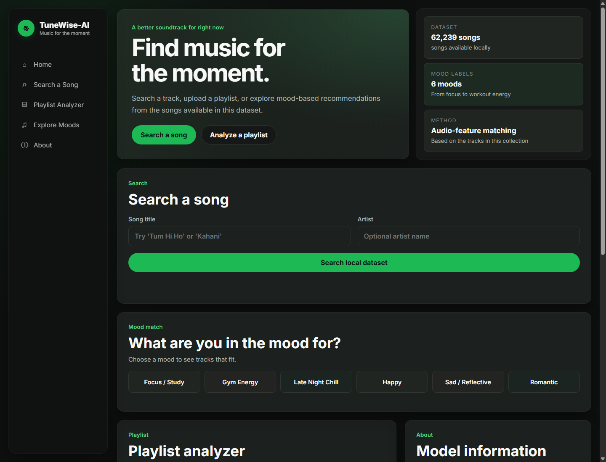
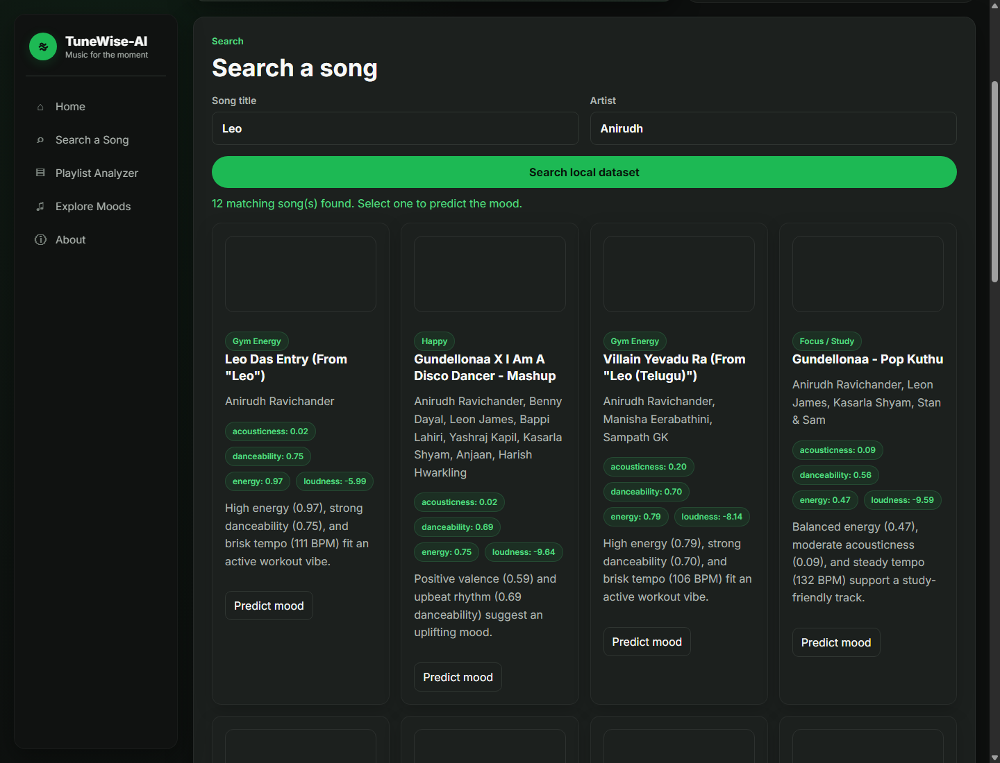
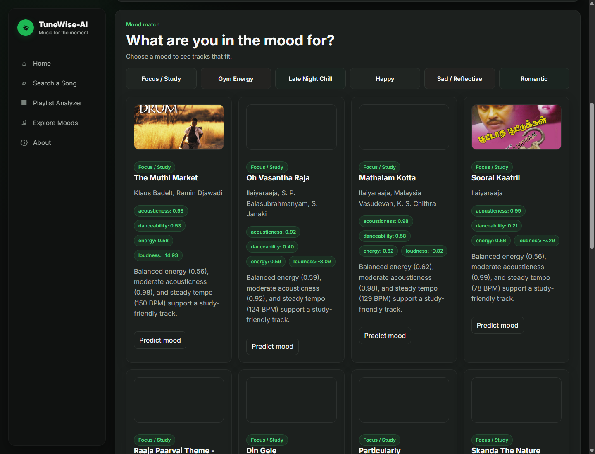
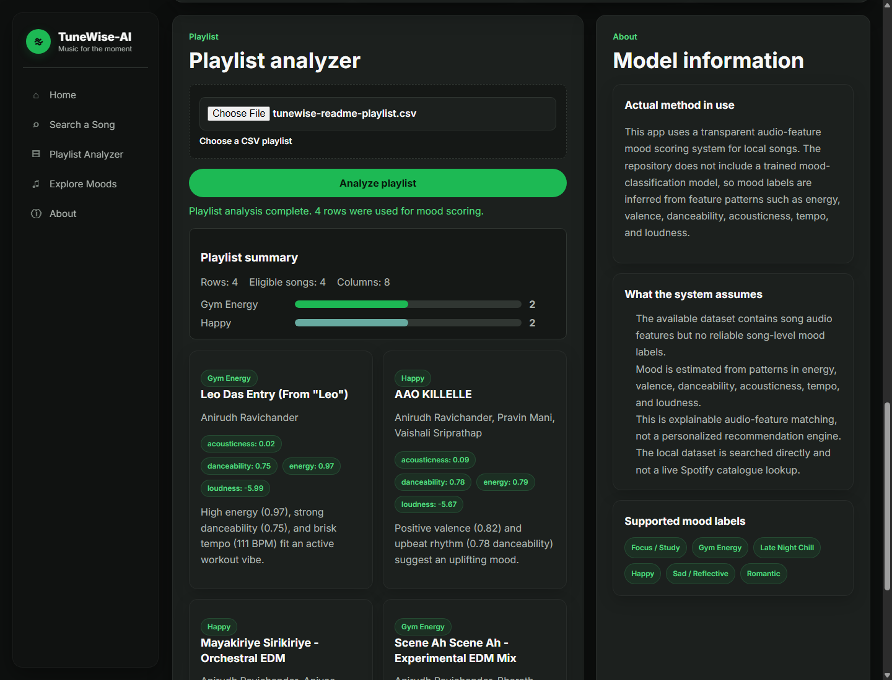
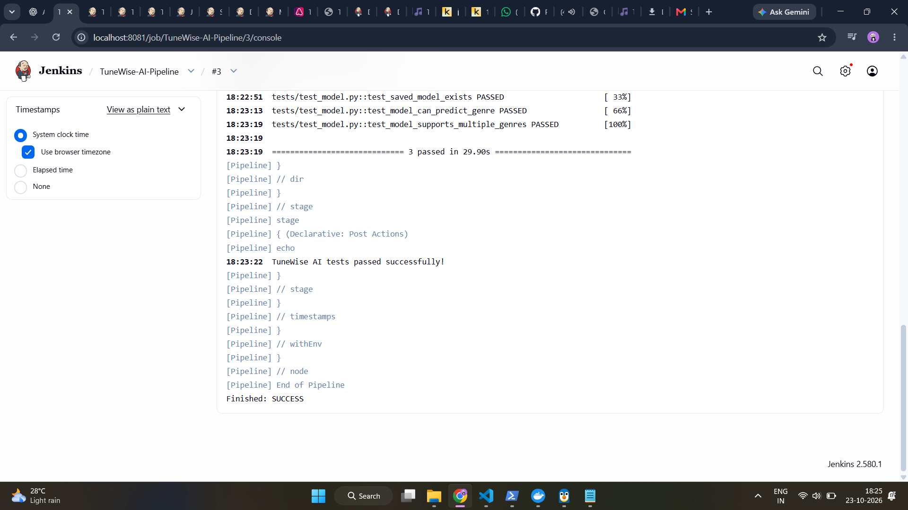
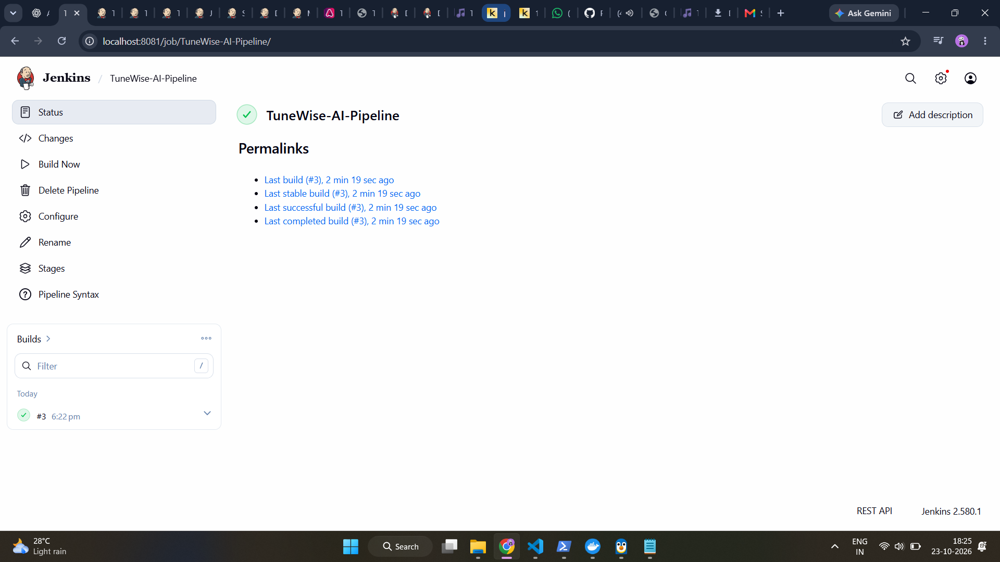

# TuneWise-AI

### Music Discovery and Playlist Analysis Web Application

TuneWise-AI is a Flask web application for searching a local music dataset, exploring mood-based recommendations, and analyzing playlist CSV files. It uses audio-feature rules to estimate moods; it does not use a trained mood classifier or the Spotify API.

## 2. Quick Links

- **GitHub repository:** [PrachiPangire/TuneWise-AI](https://github.com/PrachiPangire/TuneWise-AI)
- **Local website:** [http://localhost:5000](http://localhost:5000)
- **Local health endpoint:** [http://localhost:5000/api/health](http://localhost:5000/api/health)
- **Commit history:** [View commits on `main`](https://github.com/PrachiPangire/TuneWise-AI/commits/main)

The website and health endpoint are local development URLs. No public deployment is verified.

## 3. Table of Contents

- [4. Project Introduction](#4-project-introduction)
- [5. Project Objectives](#5-project-objectives)
- [6. Technologies Used](#6-technologies-used)
- [7. Project Structure](#7-project-structure)
- [8. How to Run Locally](#8-how-to-run-locally)
- [9. Git and GitHub Workflow](#9-git-and-github-workflow)
- [10. Docker Setup](#10-docker-setup)
- [11. DevOps Tool Integration - Jenkins](#11-devops-tool-integration---jenkins)
- [12. Testing](#12-testing)
- [13. Screenshot Evidence](#13-screenshot-evidence)
- [14. Conclusion](#14-conclusion)
- [15. Author](#15-author)

## 4. Project Introduction

Finding songs for a particular activity or mood can take time when browsing a large collection. TuneWise-AI provides a local interface to search tracks, request recommendations for a selected mood, and analyze an existing playlist from a CSV file.

Mood scores are calculated from features such as energy, valence, danceability, acousticness, tempo, and loudness. They are explainable rule-based estimates, not predictions from a trained mood-classification model.

## 5. Project Objectives

- Search the local song dataset by track title or artist.
- Recommend tracks for Focus / Study, Gym Energy, Late Night Chill, Happy, Sad / Reflective, and Romantic.
- Analyze playlist CSV files, display the mood distribution, and download the analysis results.
- Practice web development, data processing, machine-learning workflows, automated testing, and DevOps tools.

## 6. Technologies Used

### Web application

- Python and Flask for the web server and JSON API.
- HTML, CSS, and vanilla JavaScript for the browser interface.

### Data and machine learning

- pandas and NumPy for dataset cleaning, search, and playlist analysis.
- scikit-learn and joblib for separate genre-classification and popularity-regression workflows.
- Mood matching uses audio-feature scoring rules; it is not a trained mood model.
- Song search and recommendations use local CSV data. The app does not connect to Spotify's API.

### Testing

- pytest for data utility, Flask route, and model utility tests.

### DevOps

- Docker for the container configuration.
- Jenkins Declarative Pipeline for environment checks, syntax checks, pytest, and local asset reporting.
- Git and GitHub for source control.

## 7. Project Structure

```text
TuneWise-AI/
├── app.py                         # Flask routes and application startup
├── requirements.txt               # Python dependencies
├── Dockerfile                     # Container image and health check
├── .dockerignore                  # Excludes local data and build artifacts
├── .gitignore                     # Excludes local data, models, environments, and caches
├── Jenkinsfile                    # Jenkins pipeline for a Windows agent
├── templates/
│   └── index.html                 # Main web page
├── static/
│   ├── css/style.css              # Page styling
│   └── js/app.js                  # Browser interactions and API requests
├── src/
│   ├── data_utils.py              # Dataset loading and cleaning
│   ├── mood_logic.py              # Mood scoring, search, recommendations, CSV analysis
│   ├── prediction.py              # Separate saved-model helpers
│   ├── prepare_data.py            # Data preparation
│   ├── train_model.py             # Genre-classifier training
│   ├── train_popularity_model.py  # Popularity-regression training
│   └── visualizations.py          # Plotly visualization utilities
├── tests/                         # pytest test modules
├── data/                          # Local CSV datasets (not tracked)
├── models/                        # Local model artifacts (not tracked)
└── screenshots/                   # App and Jenkins evidence
```

The app needs a local `data/indian_songs.csv` file. Dataset CSVs and generated model artifacts are excluded from Git; no dataset download link is provided in this repository.

## 8. How to Run Locally

### Requirements

- Python 3.10 or later.
- The song dataset placed at `data\indian_songs.csv`.

Clone the project and create a virtual environment in Windows PowerShell:

```powershell
git clone https://github.com/PrachiPangire/TuneWise-AI.git
Set-Location .\TuneWise-AI
py -m venv .venv
.\.venv\Scripts\Activate.ps1
```

Install the dependencies:

```powershell
python -m pip install -r requirements.txt
```

Obtain the dataset separately and place it at `data\indian_songs.csv`. Then start the app:

```powershell
python app.py
```

Open [http://localhost:5000](http://localhost:5000). Check dataset availability at [http://localhost:5000/api/health](http://localhost:5000/api/health).

## 9. Git and GitHub Workflow

Git tracks the project history and GitHub hosts the repository. Before sharing changes, review the working tree and diff, stage only the intended files, commit the reviewed work, and push the selected branch. Keep local datasets, model binaries, environment files, and virtual environments out of commits.

## 10. Docker Setup

The Dockerfile uses `python:3.11-slim`, installs `requirements.txt`, exposes port `5000`, and checks `/api/health`. The local `data` directory is excluded from the image, so provide the song dataset on the host and mount it into the container.

Run these commands from the project root in PowerShell with Docker Desktop running:

```powershell
docker build -t tunewise-ai .
$dataPath = (Resolve-Path .\data).Path
docker run --rm -p 5000:5000 --mount "type=bind,source=$dataPath,target=/app/data,readonly" tunewise-ai
```

Docker execution has not been verified in this environment because the Docker engine was unavailable.

## 11. DevOps Tool Integration - Jenkins

The `Jenkinsfile` defines a Declarative Pipeline for a Windows agent with an existing checkout and Python virtual environment. Update `PROJECT_DIR` and `VENV_PYTHON` in the file to match that machine.

| Stage | Purpose |
|---|---|
| Workspace check | Reports the checkout status. |
| Environment check | Checks Python and imports Flask, NumPy, pandas, pytest, and scikit-learn. |
| Syntax / import checks | Compiles the application and selected source modules. |
| Run pytest | Runs the pytest suite. |
| Local asset report | Reports the presence of expected local datasets and model files. |

The screenshots show Jenkins build #3 marked successful, with three model tests visible in the console excerpt. They do not identify the source revision or include the full pipeline output, so they are not proof that the current `Jenkinsfile` passed. Jenkins is reachable locally, but that historical build could not be tied to the current source revision.

## 12. Testing

Run the tests from the project root:

```powershell
python -m pytest -q
```

The current test suite completed with **20 passed**. It covers dataset utilities, Flask API routes, and genre/popularity model helpers.

## 13. Screenshot Evidence

The four application screenshots below show the local Flask interface: homepage, song search, mood recommendations, and playlist CSV analysis.

**Homepage**



**Song search results**



**Mood recommendations**



**Playlist analysis**



The supplied Jenkins build screenshots are included as historical evidence only:





There is no current Docker build screenshot. The older Streamlit screenshot in the folder is not used as evidence for the Flask interface.

## 14. Conclusion

TuneWise-AI combines local song search, rule-based mood recommendations, and playlist CSV analysis in a Flask application. The project also includes separate ML utilities, automated tests, and Docker and Jenkins configurations whose verification status is documented above.

## 15. Author

Amruta Pangire
