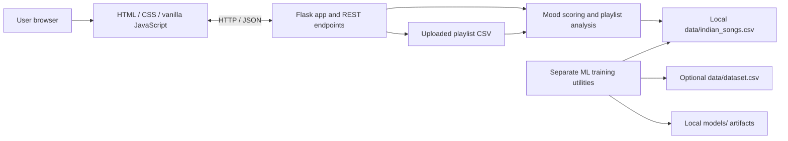

# TuneWise-AI

[](https://www.python.org/)
[](https://flask.palletsprojects.com/)
[](https://developer.mozilla.org/)
[](https://docs.pytest.org/)

TuneWise-AI is a music discovery web application for exploring a local song collection by track, audio characteristics, or listening mood. It combines a Flask API with a lightweight HTML, CSS, and vanilla JavaScript interface, and uses an explainable feature-scoring method to surface tracks for a selected mood.

> **Scope note:** Mood matching is rule-based audio-feature scoring, not a trained mood classifier. Search and recommendations use the local CSV dataset; this project does not query Spotify or another live music catalogue.

## 1. Quick Links

| Resource | Link |
|---|---|
| GitHub repository | [PrachiPangire/TuneWise-AI](https://github.com/PrachiPangire/TuneWise-AI) |
| Local web app | [http://localhost:5000](http://localhost:5000) |
| Local API health check | [http://localhost:5000/api/health](http://localhost:5000/api/health) |
| Commit history | [Commits on `main`](https://github.com/PrachiPangire/TuneWise-AI/commits/main/) |
| Public deployment | No public deployment has been verified. |

## 2. Table of Contents

- [3. Project Introduction](#3-project-introduction)
- [4. Project Objectives](#4-project-objectives)
- [5. Key Features](#5-key-features)
- [6. Technologies Used](#6-technologies-used)
- [7. System Architecture](#7-system-architecture)
- [8. Project Structure](#8-project-structure)
- [9. Prerequisites and Data Assets](#9-prerequisites-and-data-assets)
- [10. Local Installation and Run](#10-local-installation-and-run)
- [11. API Documentation](#11-api-documentation)
- [12. Testing and Quality Assurance](#12-testing-and-quality-assurance)
- [13. Docker](#13-docker)
- [14. Jenkins CI Pipeline](#14-jenkins-ci-pipeline)
- [15. Git and GitHub Workflow](#15-git-and-github-workflow)
- [16. Deployment Status](#16-deployment-status)
- [17. Screenshot Evidence](#17-screenshot-evidence)
- [18. Limitations](#18-limitations)
- [19. Future Enhancements](#19-future-enhancements)
- [20. Conclusion](#20-conclusion)

## 3. Project Introduction

Finding a track that fits a particular activity or feeling can be difficult when a music collection is large. TuneWise-AI offers a small, locally run discovery experience: search tracks in the available dataset, inspect audio-feature-based mood estimates, analyze a playlist CSV, or request recommendations for one of six supported moods.

The project is designed as an academic AIML application with a clear separation between the user interface, Flask endpoints, dataset processing, and retained model-training utilities. The current mood feature is deliberately transparent about how it works and what it cannot establish.

## 4. Project Objectives

- Provide a simple browser interface for exploring songs in a local dataset.
- Apply explainable rules to common audio features rather than misrepresenting mood estimates as a trained classifier.
- Accept playlist CSV files and summarize the moods inferred from usable feature values.
- Keep the web interface and API usable without requiring a live catalogue service.
- Preserve separate genre-classification and popularity-regression workflows without using them as mood classifiers.
- Document local development and optional container/CI configurations accurately.

## 5. Key Features

- **Local song search:** Search by title and/or artist against `data/indian_songs.csv`.
- **Mood estimate for a song:** Score audio features such as energy, valence, danceability, acousticness, tempo, and loudness using documented rules.
- **Playlist CSV analysis:** Upload a CSV file up to 5 MB and analyze rows containing usable numeric audio features.
- **Mood distribution and export:** View the playlist mood distribution, inspect analyzed tracks, and download the results as CSV.
- **Mood recommendations:** Rank local tracks for Focus / Study, Gym Energy, Late Night Chill, Happy, Sad / Reflective, and Romantic.
- **Responsive web interface:** Use the app from desktop or mobile browsers.
- **Retained ML utilities:** Keep separate scripts and helpers for the legacy genre classifier and popularity regressor. These do not power mood scoring.

## 6. Technologies Used

| Area | Technologies and verified use |
|---|---|
| Frontend | HTML template, CSS, vanilla JavaScript, browser `fetch` calls |
| Backend | Python, Flask, Flask JSON responses and template/static serving |
| Data processing | pandas and NumPy for loading, cleaning, and processing tabular data |
| Machine learning | scikit-learn and joblib in the separate genre and popularity model workflows |
| Visualization | Plotly helpers retained in `src/visualizations.py` |
| Testing | pytest; tests cover Flask endpoints, data utilities, and popularity/genre model helpers |
| DevOps | Dockerfile, Docker health check, Jenkins Declarative Pipeline, Git |

## 7. System Architecture

The Flask application serves the page and provides JSON endpoints. The browser calls those endpoints with `fetch`; song search and mood recommendations use the local Indian songs dataset. Playlist uploads are parsed in memory and analyzed with the same mood-scoring logic. The genre and popularity training scripts are separate workflows.



## 8. Project Structure

```text
TuneWise-AI/
├── app.py                          # Flask application, page route, and API endpoints
├── requirements.txt                # Python dependencies for the app and retained workflows
├── Dockerfile                      # Flask container image definition
├── .dockerignore                   # Keeps local datasets, models, and caches out of image builds
├── .gitignore                      # Excludes local data/model assets and generated files
├── Jenkinsfile                     # Windows Jenkins pipeline
├── README.md                       # Project, API, setup, and operations documentation
├── templates/
│   └── index.html                  # Main single-page interface
├── static/
│   ├── css/
│   │   └── style.css               # Responsive interface styling
│   └── js/
│       └── app.js                  # Browser interactions and API requests
├── src/
│   ├── __init__.py
│   ├── data_utils.py               # Dataset paths, validation, cleaning, and feature helpers
│   ├── mood_logic.py               # Mood scores, local search, recommendations, CSV analysis
│   ├── prediction.py               # Separate saved genre/popularity model helpers
│   ├── prepare_data.py             # Dataset preparation utilities
│   ├── train_model.py              # Legacy genre-classifier training script
│   ├── train_popularity_model.py   # Popularity-regressor training script
│   └── visualizations.py           # Plotly charts for the retained data workflow
├── tests/
│   ├── test_data_utils.py          # Dataset utility tests
│   ├── test_flask_app.py           # API endpoint tests
│   ├── test_model.py               # Genre model tests (skip if its artifact is absent)
│   └── test_popularity_model.py    # Popularity workflow tests using synthetic fixtures
├── data/                           # Local datasets; CSV files are not tracked by Git
├── models/                         # Local model artifacts; binaries are not tracked by Git
└── screenshots/                    # Existing legacy UI and historical Jenkins screenshots
```

## 9. Prerequisites and Data Assets

- Python 3.10 or newer (the Docker image uses Python 3.11).
- PowerShell on Windows for the commands below.
- Git for cloning and version control.
- A local `data/indian_songs.csv` file with the required columns defined in `src/data_utils.py`. The Flask app needs this dataset for its health check, search, and recommendations.
- Optional `data/dataset.csv` and `models/` artifacts for the separate genre/popularity workflows.
- Docker Desktop for container build/run commands.
- A Windows Jenkins agent and a prepared Python virtual environment to execute the supplied Jenkinsfile.

Dataset CSV files and generated model binaries are intentionally excluded from Git to avoid uploading large or externally sourced assets. They are also excluded from the Docker build context. Provide the required dataset locally and mount it into the container when using Docker. No dataset download URL or redistribution license is asserted by this repository.

The mood discovery app does not require a saved genre or popularity model. The genre test module skips when `models/genre_classifier.joblib` is unavailable.

## 10. Local Installation and Run

Open PowerShell and run these commands from the project directory:

```powershell
Set-Location 'E:\TuneWise-AI'

# Create an isolated environment (use Python 3.10+).
py -m venv .venv

# Install the project's declared dependencies.
.\.venv\Scripts\python.exe -m pip install --upgrade pip
.\.venv\Scripts\python.exe -m pip install -r requirements.txt
```

Place the dataset at `E:\TuneWise-AI\data\indian_songs.csv`, then start Flask:

```powershell
.\.venv\Scripts\python.exe app.py
```

Open [http://localhost:5000](http://localhost:5000). In a second PowerShell window, verify the health endpoint:

```powershell
Invoke-RestMethod -Uri 'http://localhost:5000/api/health'
```

The app binds to `0.0.0.0:5000` and runs with Flask debug mode disabled. It is a development server configuration; use a production WSGI server and appropriate operational controls before exposing it publicly.

## 11. API Documentation

All API routes return JSON except `GET /`, which serves the HTML interface. The API does not require an authentication token in the current implementation.

### `GET /api/health`

Loads and cleans the local song dataset, then reports the application status and available moods. A usable `data/indian_songs.csv` is required.

Example response:

```json
{
  "status": "ok",
  "dataset_rows": 62239,
  "moods": [
    "Focus / Study",
    "Gym Energy",
    "Late Night Chill",
    "Happy",
    "Sad / Reflective",
    "Romantic"
  ],
  "app": "TuneWise-AI"
}
```

`dataset_rows` reflects the local cleaned dataset and may differ when the supplied CSV changes.

### `GET /api/search`

Searches the local dataset. At least one query parameter is required; matching is case-insensitive and the endpoint returns at most 12 results.

| Parameter | Required | Description |
|---|---:|---|
| `q` | No | Partial song title or artist search term |
| `artist` | No | Partial artist name filter |

Example: `GET /api/search?q=Leo&artist=Anirudh`

Response shape:

```json
{
  "success": true,
  "count": 1,
  "results": [
    {
      "track_id": "dataset-track-id",
      "track_name": "Example Track",
      "artist_name": "Example Artist",
      "album_name": "Example Album",
      "year": 2020,
      "language": "Unknown",
      "popularity": 50.0,
      "artwork_url": "",
      "track_url": "",
      "mood": "Happy",
      "mood_reason": "Reason derived from the track's audio features.",
      "audio_features": {
        "energy": 0.8,
        "valence": 0.7
      }
    }
  ]
}
```

The response example is illustrative; track values depend on the local dataset. An empty search returns `success: true`, an empty `results` array, and a message.

### `POST /api/predict-mood`

Accepts a JSON object with a `features` map. A `song` object can also be supplied; the route attempts a local title/artist lookup only when no valid features were sent.

Example request:

```json
{
  "song": {
    "track_name": "Example Track",
    "artist_name": "Example Artist"
  },
  "features": {
    "energy": 0.8,
    "danceability": 0.75,
    "acousticness": 0.2,
    "valence": 0.8,
    "tempo": 128,
    "loudness": -6.5
  }
}
```

Example response shape:

```json
{
  "success": true,
  "predicted_mood": "Happy",
  "reason": "Positive valence and upbeat rhythm suggest an uplifting mood.",
  "explanation": "Mood labels are inferred from audio-feature patterns.",
  "scores": {
    "Focus / Study": 0.5,
    "Gym Energy": 0.7,
    "Late Night Chill": 0.3,
    "Happy": 0.8,
    "Sad / Reflective": 0.2,
    "Romantic": 0.6
  },
  "feature_summary": {
    "acousticness": 0.2,
    "danceability": 0.75,
    "energy": 0.8,
    "loudness": -6.5,
    "tempo": 128.0,
    "valence": 0.8
  }
}
```

Score values above are illustrative, not measured model outputs. The endpoint returns the deterministic scores calculated for the supplied features; it does not return a validated classifier confidence.

### `GET /api/recommendations`

Ranks tracks from the local dataset by the selected mood's rule score and returns up to 8 tracks.

| Parameter | Required | Supported values |
|---|---:|---|
| `mood` | Yes | `Focus / Study`, `Gym Energy`, `Late Night Chill`, `Happy`, `Sad / Reflective`, `Romantic`; aliases include `focus`, `study`, `gym`, `workout`, `chill`, `night`, `sad`, and `reflective` |

Example: `GET /api/recommendations?mood=Happy`

The response includes `success`, normalized `mood`, `count`, and `results`. Each result includes track metadata, the requested mood, `mood_score`, a mood-specific reason/explanation, and the available audio features.

### `POST /api/analyze-playlist`

Uploads a multipart form field named `file` containing a `.csv` file, up to 5 MB. Numeric audio-feature columns are used when present. Optional title and artist columns are recognized using names such as `track_name`/`title` and `artist_name`/`artist`. Rows without usable audio-feature columns cannot be scored.

Example using Windows PowerShell with `curl.exe`:

```powershell
curl.exe -X POST -F "file=@playlist.csv" http://localhost:5000/api/analyze-playlist
```

The response contains `rows`, `eligible_rows`, `columns`, a five-row `preview`, `mood_distribution`, analyzed `results`, and a `csv_download` string containing the exported CSV.

### `GET /api/model-info`

Returns the active mood-scoring description, assumptions, supported moods, and notes. Popularity metrics are returned only when the optional local `models/popularity_metrics.json` file is available.

Invalid requests return a JSON object with `success: false` and an `error` message, generally with HTTP 400. Flask enforces a 5 MB maximum request size.

## 12. Testing and Quality Assurance

Run the complete test suite from the repository root:

```powershell
.\.venv\Scripts\python.exe -m pytest -q
```

The current test suite contains **20 tests** across four test modules. The tests cover data cleaning and validation, Flask health/search/prediction/recommendation/playlist routes, and popularity model training/prediction using synthetic fixtures. The genre-classifier tests are conditional on the local saved model artifact being present.

The tests exercise feature-based mood behavior; they do not measure the accuracy of a supervised mood classifier.

## 13. Docker

The Dockerfile builds the Flask app on Python 3.11, installs `requirements.txt`, copies the application, source package, templates, and static assets, exposes port 5000, and checks `GET /api/health`. Local datasets and model files are excluded from the build context by `.dockerignore`.

Run the following in PowerShell from the repository root:

```powershell
docker build -t tunewise-ai .
docker run --rm -p 5000:5000 -v "${PWD}\data:/app/data:ro" tunewise-ai
```

The mounted host `data` directory must contain `indian_songs.csv`; otherwise the health check and dataset-backed endpoints cannot report success. Verify the running container in a second window:

```powershell
Invoke-RestMethod -Uri 'http://localhost:5000/api/health'
docker ps
```

The Docker CLI is installed in the development environment, but the Docker daemon was unavailable during this documentation update. Image build and container execution therefore remain unverified here.

## 14. Jenkins CI Pipeline

`Jenkinsfile` is a Windows Declarative Pipeline for a pre-provisioned local checkout. It uses `bat` commands and defaults to:

```text
PROJECT_DIR=E:\TuneWise-AI
VENV_PYTHON=E:\TuneWise-AI\.venv\Scripts\python.exe
```

The stages currently defined are:

1. **Workspace check** — enters the configured project folder and reports Git status.
2. **Environment check** — prints the Python version and checks imports for Flask, NumPy, pandas, pytest, and scikit-learn.
3. **Syntax / import checks** — compiles the Flask app and retained Python modules.
4. **Run pytest** — executes the test suite with verbose output.
5. **Local asset report** — reports the presence of optional local datasets and model artifacts; missing files are informational.

Before running the pipeline, install the project dependencies into the configured virtual environment, make sure the Jenkins agent is Windows, and set `PROJECT_DIR`/`VENV_PYTHON` to paths available to that agent. The pipeline does not check out source from Git itself; the configured directory must already contain the checkout. The local Jenkins executable/service was not available for verification, and the updated Jenkinsfile has not been run in this environment. The historical screenshot below is not evidence for the current pipeline revision.

## 15. Git and GitHub Workflow

The configured remote is `https://github.com/PrachiPangire/TuneWise-AI.git`, and the working branch is `main`. The repository already has at least five meaningful commits; do not create empty commits to inflate the count.

Use a review-first, non-destructive workflow for future changes:

```powershell
git status --short --branch
git diff --check
git diff

# Stage only the files intended for the change.
git add README.md Dockerfile Jenkinsfile .dockerignore .gitignore
git diff --cached --check
git diff --cached
git commit -m "docs: describe verified TuneWise-AI app and operations"

# Push only after confirming the target branch and staged commit.
git push origin main
```

Do not force-push or rewrite public history. Keep dataset CSVs, local model binaries, credentials, and `.env` files out of commits. This documentation workflow is intentionally selective; include application code only when it is part of the reviewed change.

## 16. Deployment Status

No public deployment URL or cloud hosting configuration was found or verified. The supported deployment targets evidenced by this repository are local development and the optional Docker image. Local links in this README are not public deployments.

## 17. Screenshot Evidence

The repository has a screenshot of the former Streamlit interface (`screenshots/docker-website.png`) and historical Jenkins screenshots. The Streamlit image is **not** the current Flask interface, and the Jenkins capture predates the current pipeline changes. No current Flask UI screenshot is available in the repository.

Historical Jenkins evidence (captured on 2026-10-23; not a verification of the current Jenkinsfile):


Before a final project submission, capture fresh screenshots of the current Flask home page, a mood recommendation result, playlist analysis with the distribution/download option, and the current successful test run. Replace or supplement the legacy evidence only with genuine captures from the running application and pipeline.

## 18. Limitations

- Mood labels are estimates from hand-authored feature scores, not ground-truth labels or a trained mood-classification model.
- No mood model accuracy or validated confidence metric is claimed.
- Search and recommendations are limited to the locally supplied dataset; there is no Spotify API or other live catalogue integration.
- Recommendations are not personalized from listening history or user profiles.
- Playlist analysis depends on numeric audio features in the uploaded CSV and supports uploads up to 5 MB.
- Dataset CSVs and model binaries are not distributed in this repository, so a clean clone needs the appropriate local assets for dataset-backed features.
- Flask's built-in development server is used by `python app.py`; it is not a production WSGI deployment.
- Docker and the updated Jenkins pipeline were not executable in the environment at the time this README was written.

## 19. Future Enhancements

- Add a genuinely labeled mood dataset and evaluate a supervised mood classifier using a held-out dataset.
- Improve playlist CSV column mapping and report per-row validation errors.
- Add optional external catalogue integration with documented credentials, consent, and rate-limit handling.
- Introduce a production WSGI server, container runtime hardening, and deployment health monitoring.
- Make Jenkins use a managed workspace/SCM checkout and publish test results as pipeline artifacts.
- Capture current screenshots and add repeatable UI-level tests.

## 20. Conclusion

TuneWise-AI demonstrates a complete local music-discovery workflow built around Flask, a browser-based interface, tabular audio features, and transparent mood-scoring rules. Its documentation distinguishes implemented behavior from future work, and its separate genre and popularity utilities remain clearly scoped apart from mood recommendations.
